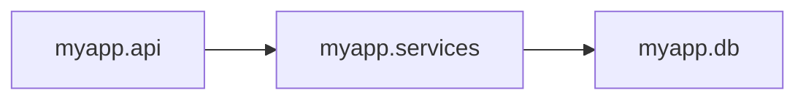

# Report Formats

[← Back to README](../README.md)

Machine-readable output for CI systems, code scanning, and dashboards.

## JSON Report Contract

`archetype check --format json` emits a versioned report contract.

Current report schema:

```text
schema_version: 2
```

Top-level fields:

- `schema_version`: report contract version
- `summary`: counts for passed, failed, warned, skipped, and total rules
- `violations`: total, new, and baseline-suppressed violation counts
- `rules`: per-rule results
- `scope`: optional changed-files metadata when `--changed-from` is used

Each rule includes:

- `name`
- `status`
- `group`
- `since_date`
- `escalate_date`
- `policy`
- `violations`
- `diagnostics`

Each violation includes:

- `module`
- `file`
- `line`
- `target`
- `message`
- `owners`: CODEOWNERS entries matching the violation's file, if a
  [CODEOWNERS file](integrations.md#codeowners-integration) is present (empty otherwise)

Example:

```json
{
  "schema_version": 2,
  "summary": {
    "passed": 2,
    "failed": 1,
    "warned": 0,
    "skipped": 0,
    "total": 3
  },
  "violations": {
    "total": 1,
    "new": 1,
    "suppressed": 0
  },
  "rules": [
    {
      "name": "api-must-not-import-db",
      "status": "failed",
      "group": "Layer boundaries",
      "since_date": null,
      "escalate_date": null,
      "policy": "error",
      "violations": [
        {
          "module": "myapp.api.users",
          "file": "myapp/api/users.py",
          "line": 7,
          "target": "myapp.db.internal.session",
          "message": "Module 'myapp.api.users' must not import 'myapp.db' (found import to 'myapp.db.internal.session').",
          "owners": ["@acme/api-team"]
        }
      ],
      "diagnostics": []
    }
  ]
}
```

Non-breaking additions keep the same schema version. Breaking shape changes increment `schema_version`.

Note: `archetype graph --format json` has its own graph export schema.

## SARIF Output

`archetype check --format sarif` emits SARIF 2.1.0 JSON for GitHub Code Scanning and other SARIF-compatible tools.

```bash
archetype check . --format sarif > archetype.sarif
```

Each Archetype rule is emitted as a SARIF rule descriptor using the rule name as the stable `ruleId`. Each violation is emitted as a SARIF result with a readable message, severity level, source module, imported target, and file/line location when available.

## Import Graph Export

Mermaid output is useful for docs:

```bash
archetype graph . --format mermaid
```



JSON output is useful for integrations:

```bash
archetype graph . --format json
```

The graph export includes `nodes` and `edges`; each edge includes `source`, `target`, `file`, and `line`.
